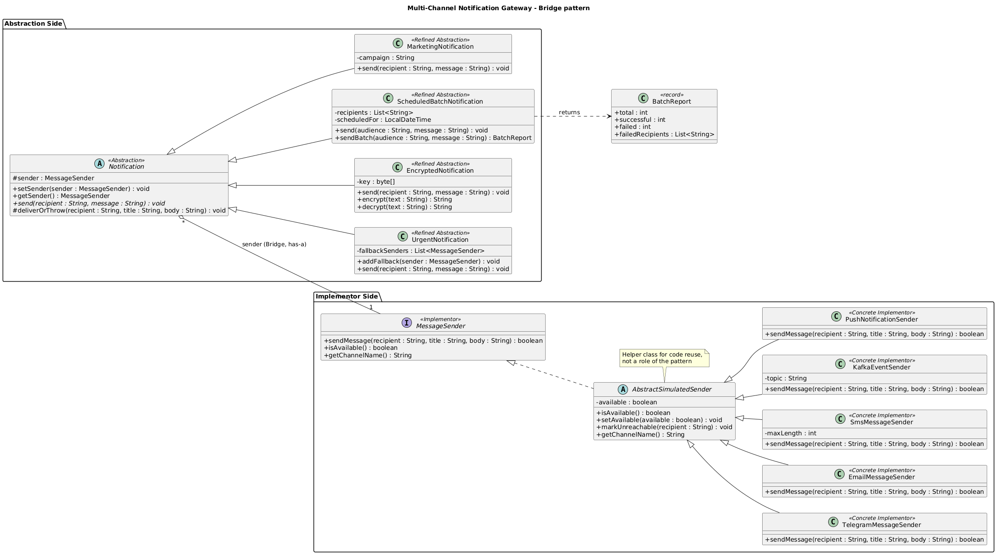

# Multi-Channel Notification Gateway

> **Assignment 3 - Bridge Pattern** | Software Design Patterns | Java 17 + Maven + JUnit 5
> **Author:** Adilzhan | Astana IT University, School of Software Engineering, group SE-2516

A notification system in which **what** is sent (urgent, encrypted, batch, marketing) and **how** it is delivered (Telegram, e-mail, SMS, Kafka, push) evolve **independently**. The demo story: the control center of an orbital station notifies its crew.

---

## Table of contents

1. [Architecture at a glance](#1-architecture-at-a-glance)
2. [Project structure](#2-project-structure)
3. [How to build, test and run](#3-how-to-build-test-and-run)
4. [Class catalogue](#4-class-catalogue)
5. [Mandatory demo scenarios](#5-mandatory-demo-scenarios)
6. [Independent extension](#6-independent-extension)
7. [Tests](#7-tests)
8. [Answers to the assignment questions](#8-answers-to-the-assignment-questions)
9. [Design decisions and simplifications](#9-design-decisions-and-simplifications)

---

## 1. Architecture at a glance



| Pattern role | Class(es) | Responsibility |
|---|---|---|
| **Abstraction** | `Notification` | Defines the notification contract (`send`) and **holds** a `MessageSender` |
| **Refined Abstraction** | `UrgentNotification`, `EncryptedNotification`, `ScheduledBatchNotification`, `MarketingNotification` | Different *kinds* of notification |
| **Implementor** | `MessageSender` (interface) | Defines how a message is physically delivered |
| **Concrete Implementor** | `TelegramMessageSender`, `EmailMessageSender`, `SmsMessageSender`, `KafkaEventSender`, `PushNotificationSender` | Different *delivery channels* |
| **The Bridge** | field `Notification.sender` | The has-a reference that connects both hierarchies |

```java
public abstract class Notification {
    protected MessageSender sender;          // <-- THE BRIDGE
    public void setSender(MessageSender s) { this.sender = s; }
    public abstract void send(String recipient, String message);
}
```

> [!NOTE]
> `AbstractSimulatedSender` is a small helper used by the five simulated providers (availability flag, delivery log). It is only code reuse and **not** a role of the pattern. A real provider could implement `MessageSender` directly.

## 2. Project structure

```
notification-gateway
|-- pom.xml
|-- README.md
|-- DEFENSE.md                      (cheat sheet for the live defense, in Russian)
|-- docs/
|   |-- uml-class-diagram.png       (UML, rendered)
|   |-- uml-class-diagram.svg
|   |-- class-diagram.dot           (Graphviz source)
|   `-- class-diagram.puml          (PlantUML source)
`-- src
    |-- main/java/gateway
    |   |-- Main.java               (mandatory demo)
    |   |-- sender/                 (Implementor hierarchy)
    |   `-- notification/           (Abstraction hierarchy)
    `-- test/java/gateway           (JUnit 5 tests)
```

## 3. How to build, test and run

Requirements: **JDK 17+** and **Maven 3.8+**.

```bash
mvn test                 # run all tests
mvn compile exec:java    # run the demo (all scenarios)
mvn package && java -jar target/notification-gateway-1.0.0.jar   # same demo from the jar
```

## 4. Class catalogue

### Implementor side (`gateway.sender`)

| Class | What makes it different |
|---|---|
| `TelegramMessageSender` | **Formatted text**: title is rendered in bold; limit 4096 characters |
| `EmailMessageSender` | Mandatory **subject** (title) and an automatic **signature** |
| `SmsMessageSender` | Body only, **hard limit 160 characters** (configurable); longer text is rejected |
| `KafkaEventSender` | **Simulates publishing an event**: recipient = record key, partition + offset |
| `PushNotificationSender` | Per-device **badge counter**, short body limit (256) - *added later* |

All of them are **simulations** (no real API calls). Each can be switched off with `setAvailable(false)`, and a single recipient can be made unreachable with `markUnreachable(name)`.

### Abstraction side (`gateway.notification`)

| Class | Behaviour |
|---|---|
| `UrgentNotification` | Adds `[URGENT]`, checks `isAvailable()`, walks a **fallback chain** (primary -> fallback 1 -> fallback 2 ...) using only the `MessageSender` interface |
| `EncryptedNotification` | Transforms the text before sending (XOR + Base64 demo cipher, with `decrypt`) |
| `ScheduledBatchNotification` | One message to many recipients, then a summary (`Total / Successful / Failed`) |
| `MarketingNotification` | Adds `[PROMO]`, the campaign name and an opt-out line - *added later* |

If a provider cannot deliver, a notification throws `DeliveryFailedException`; the batch notification catches it **per recipient** and counts it as *Failed*.

## 5. Mandatory demo scenarios

`Main` runs the six mandatory scenarios (plus one bonus with Kafka):

| # | Scenario | What it proves |
|---|---|---|
| 1 | Urgent + Telegram | Basic Bridge: type + provider combined at runtime |
| 2 | Encrypted + Email | The abstraction transforms the message, the provider adds its own format |
| 3 | ScheduledBatch + SMS | Summary `Total: 10 / Successful: 8 / Failed: 2` |
| 4 | Telegram -> Email at runtime | **The same object** changes provider via `setSender()` |
| 5 | Telegram unavailable -> SMS | Fallback through the interface, no `instanceof` |
| 6 | Marketing + Push | New type + new provider work together, nothing modified |
| 7 | *(bonus)* Encrypted + Kafka | The fourth provider through the same abstraction |

Excerpt of the real output (scenario 5):

```
  Telegram available? false
  [SMS] DELIVERED to Engineer Timur
        [URGENT] Coolant leak in Module D. Report to the control room.

  Delivered via : SMS (fallback used: true)
```

There are **no** classes such as `UrgentTelegramNotification` anywhere in the project.

## 6. Independent extension

After the base implementation, two things were added: **`PushNotificationSender`** (new provider) and **`MarketingNotification`** (new notification type).

**Not a single existing class was modified** - no `Notification`, no `MessageSender`, no other provider. The new provider works with all old notifications, and the new notification works with all old providers (see `IndependentExtensionTest`).

**Why this is the main advantage of Bridge:** because the two dimensions are connected only through the `MessageSender` interface, the cost of growth is *additive*, not multiplicative. With 4 types and 5 providers, plain inheritance would need 4 x 5 = **20** classes, and every new provider would force one more class *per type*. With Bridge there are 4 + 5 = **9** classes, and a new provider costs exactly **one** new class (Open/Closed Principle).

## 7. Tests

`mvn test` runs **44 test methods** (52 executions: parameterized tests run once per provider).

| Area | Covered by |
|---|---|
| Successful delivery | `urgentDeliversWithMarker`, `marketingWithPush`, ... |
| Unavailable provider | `unavailableProviderRefuses`, `urgentFailsWhenNothingAvailable` |
| Fallback | `urgentFallsBackToSms`, `firstAvailableFallbackWins`, `fallbackWhenPrimaryRejects`, `fallbackWorksWithAnyImplementor` |
| SMS length limit | `smsLengthLimit` (160/161), `smsCustomLimit` (120), `smsLimitIncludesPrefix` |
| Encryption | `encryptedMessageIsTransformed`, `encryptionDependsOnKey`, `encryptionHandlesUnicode` |
| Batch summary | `batchSummary` (10 / 8 / 2), `batchWithUnavailableProvider`, `batchSchedule` |
| Runtime switching | `runtimeSenderSwitching`, `switchingWorksForEncryptedToo`, `marketingRuntimeSwitch` |
| New provider (Push) | `pushWithUrgent`, `pushWithEncryptedAndBatch`, `pushAsFallback`, `pushLengthLimit` |
| New type (Marketing) | `marketingWorksWithEveryProvider` (x5), `marketingWithCustomProvider` |
| Failure scenarios | `urgentFailsWhenWholeChainDown`, `encryptedFailsWhenProviderRefuses`, `marketingFailsOnOutage`, `nullSenderRejected` |
| N x M proof | `urgentWorksWithEveryProvider` (x5) |

`TestSupport.RecordingSender` is a provider that exists **only in the tests**. Notifications work with it unchanged, which shows they depend on the interface and not on any concrete provider.

## 8. Answers to the assignment questions

**1. What are the two independent dimensions?**
(a) The **kind of notification** - what is sent and how the text is prepared: urgent, encrypted, batch, marketing. (b) The **delivery channel** - how the message physically travels: Telegram, e-mail, SMS, Kafka, push. Each dimension has its own reasons to change, and neither depends on the other.

**2. Where exactly is the Bridge?**
In the field `protected MessageSender sender` of the abstract class `Notification` (and its setter `setSender`). It is a has-a (aggregation) reference from the *Abstraction* hierarchy to the *Implementor* interface. All delivery work is delegated through it: `sender.sendMessage(...)`.

**3. Why is inheritance a bad fit here?**
Putting both dimensions into one inheritance tree gives a class for every combination (`UrgentTelegramNotification`, `EncryptedSmsNotification`, ...): 4 x 5 = 20 classes today. Each new provider adds one class per notification type, each new type adds one class per provider, and the logic of a type (e.g. the `[URGENT]` prefix) is copy-pasted into many classes. Inheritance is also fixed at compile time, so a notification could not change its channel at runtime, and fallback between channels would be impossible without conditionals.

**4. What happens when a new provider is added?**
Exactly one new class that implements `MessageSender` (this is what `PushNotificationSender` did). All four existing notification types can immediately use it, including as a fallback in `UrgentNotification`. No existing class is edited.

**5. What happens when a new notification type is added?**
Exactly one new class that extends `Notification` (this is what `MarketingNotification` did). It works at once with all five providers. No provider is edited.

**6. Why is this Bridge and not Adapter?**
*Intent and timing differ.* **Adapter** is applied *after the fact* to make two **already existing, incompatible** interfaces work together (e.g. wrapping a third-party SDK). **Bridge** is a **design decision made up front** to keep two hierarchies that are *meant to vary independently* separate: here we designed both the `Notification` hierarchy and the `MessageSender` hierarchy ourselves, and connect them through composition. (Also, `Notification` is a real hierarchy of refinements - an Adapter has only a single adaptee interface.) A `MessageSender` for some real SDK *could* internally use an Adapter, but the relationship between `Notification` and `MessageSender` is a Bridge.

## 9. Design decisions and simplifications

- **Simulated providers.** No real Telegram/SMTP/Kafka calls; the assignment asks for simulation. Each provider prints what it would send and keeps a log (`getSentMessages()`) that the tests inspect.
- **`recipient` is an opaque contact identifier** (a name here). Mapping it to a chat id, e-mail address, phone number or device token is the provider's concern. This is what makes it possible to use the *same* recipient when the notification falls back to another channel.
- **Failure model.** `sendMessage` returns `boolean` (as required by the interface); `Notification.deliverOrThrow` converts `false` into `DeliveryFailedException`. The batch notification catches it per recipient.
- **`recipient` argument of the batch notification** is an *audience label* (e.g. "Crew of the station") used in the title; the real recipients are stored in the batch.
- **"Scheduled"** is simulated: the batch stores its planned time and offers `isDue(now)`, but there is no real scheduler.
- **"Encryption"** is a demo transformation (XOR + Base64), explicitly *not* real cryptography.
- **Fallback also covers rejection**, not only unavailability: if the first provider is available but refuses the message (e.g. SMS too long), `UrgentNotification` moves on to the next one.
